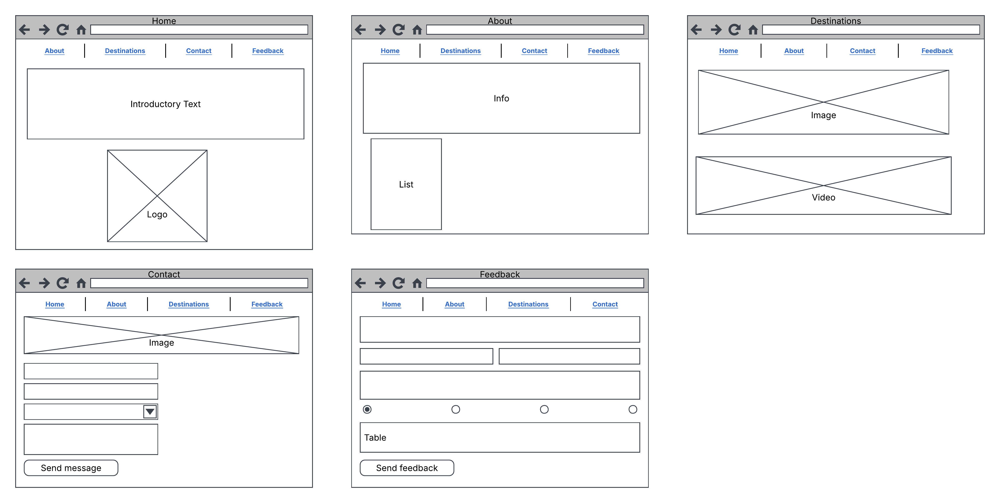

# travel-guide
## Web Pages
### About Page
Elliot
### Contact/Support Page
Sean
### Destination Page
Cathal
### Feedback Page
James
## Plan
We plan to make a travel guide website for a company called RM travel, the home page and css for the website will be co-authored by everyone and each group member will have a specific page to work on for an equal 25% contribution.  

The website will have a navigation bar that leads to an about, contact, destination and feedback page. We need to incorporate all elements of the brief so the majority of the pages will have images, the contact page will have a form, the feedback page will have a table and the destination page will have the video, we aren't sure of where to incorporate audio.  
## Wireframes

